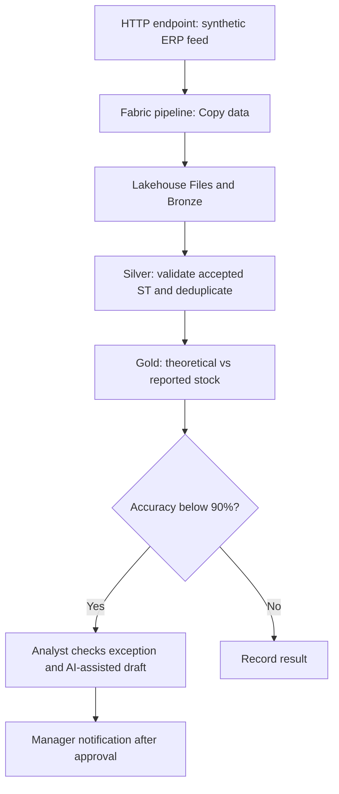

# StockSync AI Assistant
### From Inventory Data to Manager Ready Alert
**Analytics Engineer / Data Engineer**

I built this project to recreate a real-world business scenario which I encountered at work, using entirely fictional data. I built an end-to-end inventory reconciliation process in **Microsoft Fabric**: ingesting ERP data, transforming it through Bronze, Silver and Gold layers, and identifying discrepancies that need attention. By combining Fabric analytics with AI-assisted manager communication, the project shows how I turn validated data into actionable insights and support timely operational follow-up. The proposed workflow includes analyst approval and automated email delivery to managers.

> **Business setting.** ACB Company is a multinational e-commerce company that works with distribution partners across Europe. As a Data Analytics Engineer, my task is to bring ERP inventory movements, partner sales transactions and reported stock into one trustworthy daily view, identify mismatches, and prepare a clear manager follow-up.

## At a glance

| Question | Answer |
| --- | --- |
| What is compared? | Theoretical stock from opening inventory and accepted sales versus the partner's reported stock. |
| What triggers review? | Reconciliation accuracy below **90%**. |
| What has run in Fabric? | HTTP data → Lakehouse Files → PySpark notebook → Bronze, Silver and Gold Delta tables. |
| What does AI do? | Drafts manager-facing wording from verified facts; it does not calculate quantities or decide the threshold. |
| What can I reproduce here? | The synthetic input and a dependency-free Python checker for the three daily snapshots. |

## Business scenario and outcome

A manager can spend much of a morning consolidating partner reports, sales and stock records. In the underlying real-world workflow, on-site testing showed that data processing and review time decreased from approximately **four hours to 30 minutes**. This synthetic Fabric demo illustrates the approach; its runtime is not the basis for that measurement. The showcased exception is partner **P001**, product **PROD-A**, on **22 November 2026**:

| As-of date | Theoretical | Reported | Variance | Accuracy | 90% target |
| --- | ---: | ---: | ---: | ---: | --- |
| 2026-11-20 | 90 | 86 | 4 | 95.6% | Met |
| 2026-11-21 | 86 | 86 | 0 | 100.0% | Met |
| 2026-11-22 | 86 | 70 | 16 | 81.4% | **Below target** |

The reported stock of 70 is a partner snapshot; the 16-unit variance alone does not establish whether sales were missing, stock was late, or another event occurred.

## How this project works



1. **Schedule and ingest**. The Fabric pipeline has an active daily schedule set for 08:00 (Central European time). Its Copy data activity retrieves a public synthetic JSON file over HTTP as a stand-in for an internal ERP API feed and saves it to the `LH_Reconciliation` Lakehouse. On successful completion, the pipeline triggers a notebook for processing. A manual pipeline run succeeded.
   
   

2. **Stage and transform.** The pipeline copies the JSON into `LH_Reconciliation/Files`. PySpark reads and flattens the nested JSON into `bronze_st`, `bronze_inventory_movements` and `bronze_partner_inventory`. The current notebook also validates accepted sales and deduplicates records into `silver_st_validated` using PySpark.
 

3. **Reconcile.** `gold_inventory_reconciliation` compares as-of stock and produces variance and accuracy. `gold_manager_alerts`, `gold_manager_messages_routed` and `gold_ai_prompt_requests` prepare the exception and communication inputs. Accuracy = 1 − abs(variance) / theoretical quantity

   

4. **Review and communicate.** An analyst checks source records, submission dates and the prepared message before manager delivery. A reviewer view and approved email delivery are the next integration steps.
**Prompt for AI automated message**
> Dear [manager_name],
> Today is [message date]. The reconciliation accuracy for [as_of_date] is [accuracy_rate as a percentage with two decimal places], below the 90% target.
> Details: Partner [partner_id], Product [product_id] — theoretical inventory: [theoretical_quantity]; reported inventory: [actual_quantity]; variance: [variance].
> Please verify the sales records, inventory report, and submission dates to identify the cause of the variance. If needed, please contact the partner to follow up.
> Thank you for your support and cooperation.
> IT Business Service Team

Rules: Do not invent facts or claim the cause is confirmed. Return only the message body.

The example below was drafted separately with ChatGPT from verified reconciliation facts. The Fabric AI call did not produce this message, and no email was sent.

> Dear Tom Cruise,  
> As of November 22, 2026, partner P001's reconciliation rate for PROD-A is 81.4%, below the 90% target. The theoretical stock is 86 units and the partner reported 70 units, a variance of 16 units. Please verify the sales records, inventory report, and submission dates to identify the cause of the variance. If needed, contact the partner accordingly.  
> Thank you for your support and cooperation.  
> IT Business Service Team

### Calculation and timing rules

```text
Theoretical quantity = opening inventory + signed inventory movements
                       − distinct ACCEPTED sales submitted by the as-of date
Variance             = theoretical quantity − reported quantity
Accuracy             = 1 − abs(variance) / theoretical quantity
```

If theoretical quantity is zero or negative, the checker marks the row for review. `reporting_date` is the **actual sale date**; `submitting_date` is when the sale was submitted. For this demo's system as-of snapshot, an accepted sale reduces stock on its submitting date. A rejected sale has no effect, and duplicate ST-004 is excluded by partner, product, serial number, PO and sale date. Historical daily results appear in the fixture; a durable SCD2/history implementation remains future work.

## Reproduce the numbers

Clone this repository and run with Python 3; no packages, credentials or Fabric account are needed for the local check:

```bash
git clone https://github.com/heymandym/Stocksync-AI-Assistant.git
cd Stocksync-AI-Assistant
python scripts/reconcile_demo.py
python scripts/reconcile_demo.py data/mock/StockSync_mock_api_v1.json
```

The default v2 fixture prints three dated rows and asserts quantities against `expected_demo_results`. The v1 fixture contains the first two dates. To demonstrate Fabric, create a Lakehouse, attach it as the notebook default, configure the HTTP Copy data source for [v2 JSON](data/mock/StockSync_mock_api_v2.json), set the Binary destination in Lakehouse Files, and connect the notebook on Copy data success. The notebook shown in the Fabric demo is **not yet exported into this repository**. The local script is the reproducible calculation reference. For future development, I plan to use Spark SQL as the primary tool for relational cleaning and reconciliation rules, while retaining PySpark for parsing the nested JSON and other processing where it fits better. This SQL refactor has not yet been implemented or validated in Fabric.

## AI-assisted manager message

Numerical results and the 90% flag are computed before any model step. The prompt request table contains only reconciliation facts for the model to phrase. 

This is a demo project. The AI-assisted manager message has been prepared for review but has not been sent. Automated email delivery is part of the proposed workflow.

## Repository contents

| Path | Purpose |
| --- | --- |
| [v1 JSON](data/mock/StockSync_mock_api_v1.json) | Accepted, rejected, corrected and duplicate sales; two inventory dates. |
| [v2 JSON](data/mock/StockSync_mock_api_v2.json) | Adds the 22 November below-target snapshot. |
| [local checker](scripts/reconcile_demo.py) | Reproduces quantities, accuracy and threshold from the JSON. |
| [demo evidence](docs/demo-evidence.md) | Fabric setup, observed run, validation cases and remaining work. |

All partner identifiers and records are fictional. No employer data, internal API address, manager email or credential is included.
